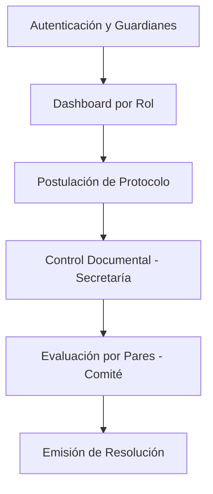

# 📊 Informe de Análisis del Proyecto y Aseguramiento de Calidad (QA)

Este informe presenta un análisis exhaustivo del frontend de **CEISH Espoch**. Se evalúan los flujos funcionales completos, las inconsistencias arquitectónicas (flujos rotos/incompletos), la redundancia de lógica (flujos repetitivos), y se establece una estrategia detallada para alinear el proyecto con la **Constitución del Proyecto** y sus controles de calidad obligatorios.

---

## 🧭 1. Análisis de Flujos Completos (Functional Flows)

Se validó que el sistema cuenta con los siguientes flujos de trabajo funcionales y mapeados correctamente en la arquitectura de red:



### 1.1 Autenticación y Seguridad
* **Implementación:** Protegido con `AuthGuard` y `VerificadoGuard` en [app.routes.ts](file:///D:/Frontend-CEISH/ceish-espoch-frontend/src/app/app.routes.ts) y [protocols/routes.ts](file:///D:/Frontend-CEISH/ceish-espoch-frontend/src/features/protocols/routes.ts).
* **Manejo de Red:** [error.interceptor.ts](file:///D:/Frontend-CEISH/ceish-espoch-frontend/src/infrastructure/interceptors/error.interceptor.ts) implementa la lógica para capturar errores de sesión (HTTP 401), realizar el refresco asíncrono de tokens (`refreshToken()`), reenviar la petición original o desloguear al usuario en caso de fallo.
* **Control de OTP:** Redirección automática a confirmación de email (código OTP) si la cuenta no ha sido verificada (HTTP 403).

### 1.2 Recepción y Control Documental en Secretaría
* **Implementación:** Flujo mapeado a través de la bandeja de validación ([protocol-validation-list.page.ts](file:///D:/Frontend-CEISH/ceish-espoch-frontend/src/features/protocols/presentation/pages/protocol-validation-list/protocol-validation-list.page.ts)).
* **Detalle de Validación:** Secretaría puede aprobar, observar o rechazar cada documento del checklist de forma independiente utilizando `updateRequirementStatus()` en [protocol-api.adapter.ts](file:///D:/Frontend-CEISH/ceish-espoch-frontend/src/infrastructure/adapters/protocol-api.adapter.ts).
* **Finalización:** La validación se cierra enviando la verificación completa con la lista de pendientes (`verifyProtocol`), y el endpoint de certificado de recepción se consume correctamente retornando un Blob descargable.

### 1.3 Asignación y Evaluación por Pares
* **Implementación:** Mapeado en la carpeta de características `src/features/evaluations/`.
* **Características:** Permite la estratificación del riesgo por evaluadores, formularios de evaluación ética y técnica basados en el anexo 9, y consolidación de veredictos unánimes o en pleno.

---

## 🚨 2. Análisis de Flujos Rotos e Incompletos (Broken Flows)

Se identificaron desviaciones importantes respecto a los principios de la Clean Architecture y debilidades en la implementación técnica:

### 2.1 Bypass Arquitectónico (UI Directo a Puerto)
* **El Problema:** La arquitectura limpia exige que la capa de presentación consuma **Casos de Uso** (Capa de Aplicación). Sin embargo, casi todos los componentes UI inyectan directamente `IProtocolRepositoryPort` (Dominio) y llaman a los adaptadores directamente (ej. `this.protocolRepo.getAll()`).
* **Impacto:** Acoplamiento directo de las vistas a las firmas del repositorio, lo que dificulta el testing unitario y anula el propósito de la capa de Casos de Uso.
* **Ubicaciones Detectadas:**
  * [protocol-list.page.ts](file:///D:/Frontend-CEISH/ceish-espoch-frontend/src/features/protocols/components/protocol-list.page.ts#L124)
  * [protocol-validation-detail.page.ts](file:///D:/Frontend-CEISH/ceish-espoch-frontend/src/features/protocols/presentation/pages/protocol-validation-detail/protocol-validation-detail.page.ts#L491)
  * [resolution-generator.page.ts](file:///D:/Frontend-CEISH/ceish-espoch-frontend/src/features/resolutions/presentation/pages/resolution-generator/resolution-generator.page.ts#L807)

### 2.2 Mocks Hardcodeados en la Capa de Presentación
* **El Problema:** En la vista de detalle del protocolo ([protocol-detail.page.ts](file:///D:/Frontend-CEISH/ceish-espoch-frontend/src/features/protocols/components/protocol-detail.page.ts#L125-L142)), el método `loadProtocol()` contiene datos mockeados en duro en lugar de conectarse con el caso de uso o el puerto del repositorio.
* **Impacto:** El flujo de visualización de detalles está roto en términos de integración con el backend.

### 2.3 Persistencia de CV en LocalStorage
* **El Problema:** En la edición de perfil del investigador ([profile.page.ts](file:///D:/Frontend-CEISH/ceish-espoch-frontend/src/features/dashboard/presentation/pages/profile/profile.page.ts#L1350-L1353)), el archivo de hoja de vida (CV) se guarda como una cadena Base64 en `localStorage` (`ceish_investigator_cv_data`).
* **Impacto:** Esta práctica causa un error fatal de cuota de memoria (`QuotaExceededError`) cuando el investigador carga un archivo PDF de tamaño medio/grande. Los archivos y documentos deben gestionarse a través de endpoints dedicados de subida a disco/S3 y guardar solo la URL de referencia.

### 2.4 Bloqueo de Componentes Gigantes (Component Bloat)
* **El Problema:** Componentes clave tienen tamaños desproporcionados ([protocol-validation-detail.page.ts](file:///D:/Frontend-CEISH/ceish-espoch-frontend/src/features/protocols/presentation/pages/protocol-validation-detail/protocol-validation-detail.page.ts) con 41KB y [resolution-generator.page.ts](file:///D:/Frontend-CEISH/ceish-espoch-frontend/src/features/resolutions/presentation/pages/resolution-generator/resolution-generator.page.ts) con 37KB).
* **Impacto:** Estos archivos acumulan lógica de enmaquetado PDF, cálculo de estadísticas, dibujo de gráficos y control del DOM, violando el principio de responsabilidad única.

---

## 🔄 3. Análisis de Flujos Repetitivos (Repetitive Flows)

Se encontraron patrones duplicados que atentan contra el principio DRY (Don't Repeat Yourself):

1. **Lectura y Conversión de Archivos:**
   La lógica para leer archivos adjuntos, validar su tipo (PDF) y convertirlos a base64 se repite en múltiples páginas del investigador y evaluadores. Debe centralizarse en un helper en `src/shared/utils/file.utils.ts`.
2. **Mapeo de Colecciones en Adapters:**
   Métodos como `extractAndMapList()` y `extractAnyArray()` se duplican a lo largo de varios adaptadores HTTP de infraestructura. Deberían consolidarse en una clase base común de adaptador de red.
3. **Manejo local de Toast y Modales de Error:**
   Cada componente inyecta `MatSnackBar` o modales personalizados de error y repite la misma lógica de "Error al cargar los datos". Debería gestionarse a nivel de interceptor global o mediante un servicio centralizado de notificaciones.

---

## 🛠️ 4. Plan de Alineación con Controles de Calidad Obligatorios

Para cumplir con el **Fase 3: Validación y Aseguramiento** de la Constitución del Proyecto, se establece el siguiente plan de acción técnico:

### 🧪 4.1 Plan de Pruebas Unitarias (Unit Testing)
Dado que solo existen 2 pruebas en todo el sistema, se implementará la cobertura siguiendo estos lineamientos:

1. **Testing de Casos de Uso:**
   * Crear archivos `*.spec.ts` para cada caso de uso (ej. `get-all-protocols.use-case.spec.ts`).
   * Utilizar espías de Jasmine (`jasmine.createSpyObj`) para mockear los puertos de repositorio:
     ```typescript
     const mockRepo = jasmine.createSpyObj('IProtocolRepositoryPort', ['getAll']);
     mockRepo.getAll.and.returnValue(of(mockProtocolsList));
     ```
2. **Testing de Componentes UI:**
   * Importar `HttpClientTestingModule` en el bloque `TestBed.configureTestingModule` para aislar las llamadas HTTP.
   * Probar el renderizado condicional de los botones de carga y la visualización de inmutabilidad (badges de aprobados).

### 📊 4.2 Métricas de Calidad Estáticas
* **Eliminar `any`:** Refactorizar las señales y servicios. Por ejemplo:
  * *Antes:* `protocol = signal<any>(null)`
  * *Después:* `protocol = signal<ProtocolEntity | null>(null)`
* **Refactorización de Páginas Gigantes:** Dividir `protocol-validation-detail.page.ts` en subcomponentes:
  * `ValidationHeaderComponent`
  * `ValidationChecklistComponent`
  * `ValidationSummaryComponent`
* **Linter de Angular:** Configurar y ejecutar `npm run lint` semanalmente para corregir variables no utilizadas, importaciones redundantes e inconsistencias de formato.

### 🔍 4.3 Procedimientos de QA (Aseguramiento de Calidad)
1. **Regresión Manual:**
   * Diseñar pruebas con múltiples pestañas abiertas del navegador para validar la respuesta **HTTP 409 (Concurrency Conflict)**.
2. **QA de Integridad del LocalStorage:**
   * Reemplazar la persistencia en base64 de CVs en la edición del perfil del investigador por una subida HTTP directa antes de que el código llegue a producción.
3. **Revisión Obligatoria de PRs:**
   * Establecer una regla de GitHub/GitLab que impida hacer merge a `develop` sin la aprobación de al menos un revisor que certifique el desacoplamiento de Clean Architecture.
