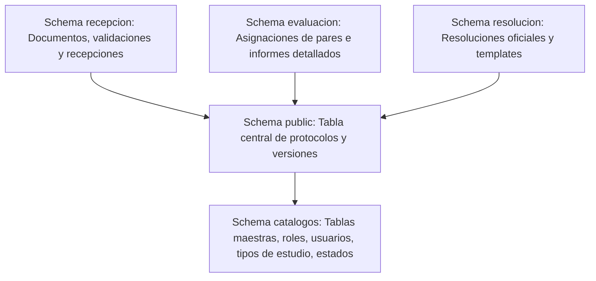

# 📊 Informe de Análisis Técnico del Backend (CEISH-ESPOCH)

Este informe presenta un análisis profundo de la arquitectura, base de datos, seguridad, flujos transaccionales y calidad de código del backend de la plataforma **CEISH-ESPOCH** (NestJS 11 + PostgreSQL + TypeORM). El objetivo es identificar vulnerabilidades, discrepancias de integración con el frontend y plantear la ruta de refactorización.

---

## 🏛️ 1. Análisis Arquitectónico del Backend

El backend está desarrollado con **NestJS 11** y TypeScript, estructurado bajo un enfoque de **Arquitectura Hexagonal / Clean Architecture** organizada por módulos de dominio.

### 1.1 Estructura Interna de los Módulos
Cada módulo en `src/modules/<nombre-modulo>/` está segregado en tres capas:
1. **Domain (Núcleo):** Contiene las interfaces (puertos) y las reglas de negocio puras.
2. **Application (Casos de Uso):** Contiene los servicios de aplicación, mappers y los Data Transfer Objects (DTOs) que orquestan el flujo de datos.
3. **Infrastructure (Detalle Técnico):** Aloja los controladores NestJS (`*.controller.ts`), las entidades del ORM (`*.entity.orm.ts`) y la implementación de los repositorios que conectan con TypeORM (`*.typeorm.repository.ts`).

* **Evaluación de la Arquitectura:** El desacoplamiento es de alto nivel. Los controladores son delgados y delegan la lógica transaccional a servicios específicos, cumpliendo con el principio de responsabilidad única.

---

## 🗄️ 2. Análisis del Modelo de Datos (PostgreSQL & TypeORM)

La base de datos PostgreSQL se divide en **schemas semánticos** según los subprocesos del flujo de evaluación ético-científica del comité (PET):

### 2.1 Puntos Clave de la Estructura DB:
* **Entidad `public.protocolos`:** Es la entidad principal. Almacena referencias al investigador principal, tipo de estudio, nivel de riesgo y un puntero de versión activa (`version_actual_id`) hacia `public.versiones_protocolo`.
* **Entidad `public.versiones_protocolo`:** Soporta el versionamiento de expedientes. Almacena las observaciones de resoluciones previas, fechas límite y estado de subsanación.
* **Separación de Documentos:** Los archivos se administran en `recepcion.documentos` asociados al protocolo y a su número de versión correspondiente.

---

## 🔒 3. Seguridad, Criptografía y Protección de Datos

El backend implementa controles estrictos basados en estándares de seguridad (NIST & ISO):

### 3.1 Protección contra Denegación de Servicio (DoS)
* **Doble Capa de Rate Limiting (ThrottlerModule):**
  * *Capa Burst (Segundos):* Límite de 5 peticiones por segundo para mitigar ataques automatizados rápidos.
  * *Capa Normal (Minuto):* Límite de 100 peticiones por minuto.
  * **Intercepción:** El filtro `ThrottleExceptionFilter` responde con códigos estándar e incluye la cabecera HTTP `Retry-After` para avisar al cliente cuándo reintentar.
* **Middleware global `DosDefenseMiddleware`:** NIST SC-5 (DoS Protection) aplicado de forma global antes de evaluar controladores.

### 3.2 Criptografía de Datos de Carácter Personal (PII)
* **Encriptación en DB:** Se encriptan datos sensibles del investigador (ej. números telefónicos, cédula) utilizando AES-256-CBC mediante `EncryptionService` y el transformer de base de datos (`encryption.transformer.ts`).
* **Auditoría Transaccional:** El decorador `@Audit('ACTION_NAME')` combinado con el interceptor global `AuditInterceptor` registra de forma automática qué usuario modificó qué dato en qué momento, garantizando la trazabilidad forense.

---

## 🔄 4. Evaluación del Flujo de Emisión de Resoluciones (Iteración 2)

El método `createResolution` en [resolutions.service.ts](file:///C:/Users/Usuario/Desktop/8vo/API%20II/CEISH-ESPOCH/src/modules/resolutions/application/services/resolutions.service.ts#L62-L321) es el motor transaccional que gestiona el paso de V1.0 a V2.0+:

### 4.1 Ciclo Transaccional e Inconsistencias Detectadas:
1. **Motor de Decisión (`determineResolutionType`):** Calcula automáticamente el tipo de dictamen consolidador:
   * Si al menos un evaluador tiene dictamen `RECHAZADO` (3) -> Resolución Global: `RECHAZADO` (3).
   * Si no hay rechazos pero hay al menos un `APROBADO_CON_OBSERVACIONES` (2) -> Resolución Global: `APROBADO_CON_OBSERVACIONES` (2).
   * Si todos aprueban -> Resolución Global: `APROBADO` (1).
2. **Manejo de Transacciones de Base de Datos:** Utiliza `QueryRunner` de TypeORM con transacción explícita (`startTransaction`). Si ocurre un error, realiza rollback completo de los cambios de versión.

### 4.2 Inconsistencia Crítica Frontend-Backend (Mapeo de Requisitos V2.0):
* **Comportamiento del Backend (Líneas 246-265):**
  Al emitir un dictamen Tipo 2 (`APROBADO_CON_OBSERVACIONES`), el backend recorre los requisitos documentales previos:
  * Si el requisito estaba en estado `APROBADO`, en la nueva versión **se cambia a `PRESENTADO`** (para conservar el archivo pero permitir corregirlo).
  * Si el requisito estaba observado/rechazado, **se resetea a `NO_PRESENTADO`**.
* **La Fricción con el Frontend:** El plan de implementación del frontend especifica que los documentos aprobados en la versión anterior deben ser **inmutables (no editables)**.
  * **Problema:** Si el backend cambia el estado de `APROBADO` a `PRESENTADO`, el frontend leerá el estado `PRESENTADO` y podría habilitar el input de subida de archivos (Drag & Drop) para documentos que no requieren corrección.
  * **Solución Propuesta:** Ajustar la lógica del frontend para bloquear la carga de cualquier documento que ya tenga una URL de archivo asociada en versiones anteriores, independientemente de si el estado devuelto por el backend es `PRESENTADO`.

---

## 🚨 5. Estado de la Calidad del Código (Testing y ESLint)

* **Pruebas Unitarias Inexistentes:** Aunque el archivo `package.json` incluye Jest y comandos de cobertura de tests (`npm run test:cov`), no hay tests unitarios en la carpeta `src/modules/` para controladores ni servicios. Toda la lógica del backend carece de pruebas automatizadas antes del despliegue.
* **Control de Concurrencia Limitado:** El backend captura el error de concurrencia mediante el código de violación de restricciones únicas de PostgreSQL (`23505`) al intentar insertar una versión duplicada en `versiones_protocolo`. Sin embargo, esto no cubre modificaciones concurrentes sobre el estado del protocolo una vez creado. Se requiere la implementación de `@VersionColumn` de TypeORM para asegurar locking optimista completo.

---

## 📝 6. Conclusiones y Recomendaciones del Análisis del Backend

1. **Ajustar el Estado de los Requisitos:** El backend debe mantener el estado de los documentos previamente aprobados como `APROBADO` o habilitar una bandera `isImmutable` en el DTO de checklist, evitando setearlos a `PRESENTADO` si no deben modificarse.
2. **Añadir Bloqueo Optimista Completo:** Incorporar un campo de versión incremental en `ProtocolOrmEntity` mediante la directiva `@VersionColumn` para que cualquier guardado lance un error de versión obsoleta.
3. **Desplegar Cobertura de Tests:** Priorizar la escritura de unit tests para el cálculo automático de dictámenes de resoluciones (`determineResolutionType`) y para las transacciones complejas de cambio de versión en `ResolutionsService`.
